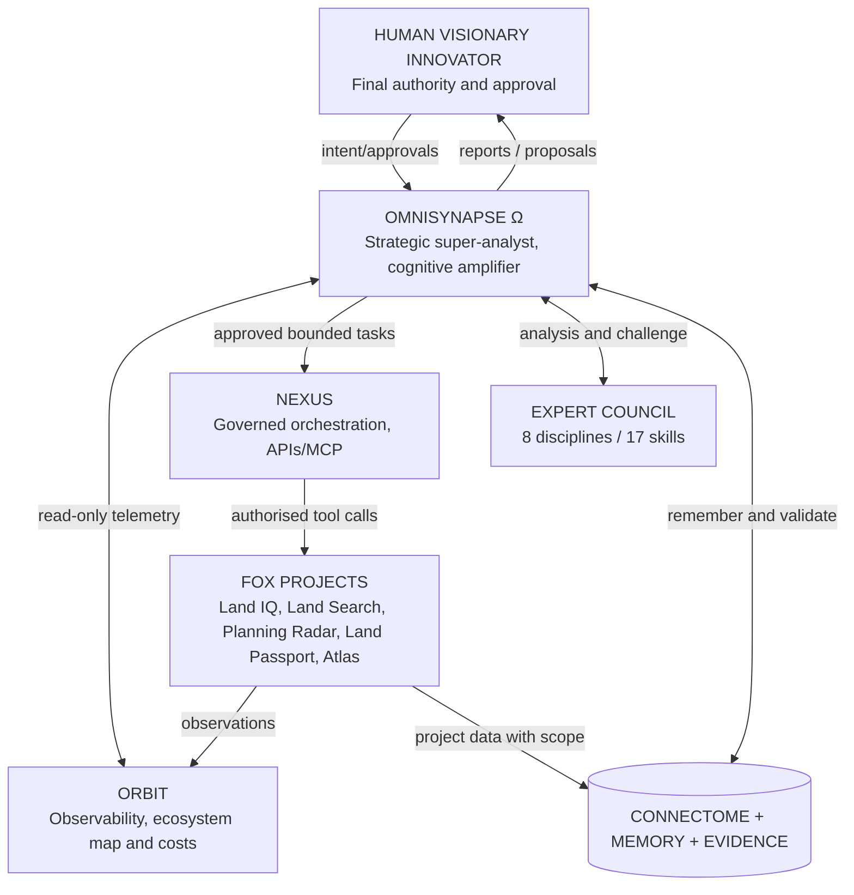

# FOX intelligence hierarchy: responsibility and data flows



## Distinct roles

- **Human:** deciding whether recommendations matter; budget, final direction, deployment, external communication and account permissions.
- **OMNISYNAPSE:** strategy, discovery, evidence integration, cognitive amplification, specialist debate, evaluation and recommendations.
- **ORBIT:** observability and visual status of connected services; no silent auto-discovery across private accounts.
- **NEXUS:** execution gateway with authenticated connectors, task policies, secure logs and approval enforcement. It must not implement uncontrolled 'self-improvement'.
- **Specialist council:** expert-role reasoning and testing, flagged as simulated if not distinct actual agents/models.
- **FOX tools:** independent products with APIs and separate ownership, release and tenancy concerns.
- **Memory / connectome:** common data architecture, not an LLM's unsupervised conversational memory.

## Mandatory separation of responsibilities

Strategic recommendation != user approval != task execution != evidence of success. State transitions are `proposed -> reviewed -> approved -> queued -> running -> verified_complete|failed|rolled_back`. OMNISYNAPSE cannot declare its own high-risk proposals approved. ORBIT provides independently observed task outcomes.

## Cognitive amplifier

A user-facing layer includes rapid site/project recall, option explanations, scenario cards, 'why did we decide that?', evidence-linked summaries, suggestions based on recorded working patterns and consented voice modes. Do not infer private health/cognitive data from behaviour without a lawful basis and explicit controls.

## Dedicated separate agent

Recommended backend topology:

```
Owner-only OMNISYNAPSE UI (responsive)
        ↓  OAuth/session + RBAC
Strategic orchestrator API
    ├── Read-only ORBIT adapter
    ├── NEXUS approval/task adapter
    ├── Research collector + source registry
    ├── Council reasoning and validation
    ├── Memory + vector search + typed connectome graph
    ├── Opportunity scorer + evaluation harness
    └── Daily brief dispatcher (opt-in; avoid duplicate scheduled tasks)
```

Public-facing service should expose only a marketing landing page and voluntary interest registration, never project data or private intelligence. Owner-only access to actual commands and briefs.
